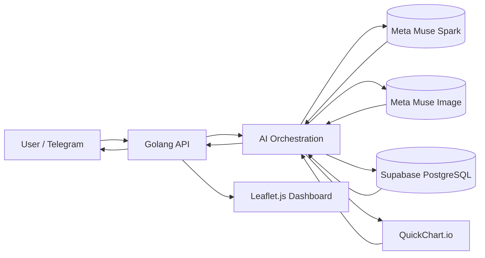

<div align="center">

# 🚛 FMS AI Lumajang

### Intelligent Fleet Management System: empowering local truck drivers in Lumajang with Meta AI to prevent breakdowns and traffic jams.


[🎬 Demo](#-demo) · [✨ Features](#-key-features) · [🏗️ Architecture](#%EF%B8%8F-architecture) · [⚡ Quick Start](#-quick-start) · [🗺️ Roadmap](#%EF%B8%8F-roadmap)

<!-- Replace with a GIF or screenshot of your best moment -->


</div>

---

## 📌 Table of Contents

1. [The Problem](#-the-problem)
2. [Our Solution](#-our-solution)
3. [Demo](#-demo)
4. [Key Features](#-key-features)
5. [How We Use Meta AI](#-how-we-use-meta-ai)
6. [Architecture](#%EF%B8%8F-architecture)
7. [Tech Stack](#-tech-stack)
8. [Quick Start](#-quick-start)
9. [Usage Examples](#-usage-examples)
10. [Project Structure](#-project-structure)
11. [Results & Impact](#-results--impact)
12. [Challenges & Lessons Learned](#-challenges--lessons-learned)
13. [Roadmap](#%EF%B8%8F-roadmap)
14. [Team](#-team)
15. [License & Acknowledgements](#-license--acknowledgements)

---

## 🔥 The Problem

> Lumajang is a major sand-mining and agricultural region in East Java. Trucks haul sand, sugarcane, timber, and livestock along narrow local roads every day, and most are owned by individuals who have no affordable way to monitor vehicle health.

- **Who suffers?** Independent truck drivers, small fleet owners, and local logistics managers.
- **What goes wrong today?** Breakdowns happen without warning. A single stalled truck can block a narrow road for hours, causing traffic jams and lost income for everyone behind it.
- **What does it cost?** One engine overheat can mean millions of rupiah in repairs and lost earnings, plus hours of road blockage.

Existing approaches (manual checks, generic GPS trackers) fall short because they are **too expensive**, **too slow**, and **not explainable** to drivers who need instant, actionable advice in plain language.

## 💡 Our Solution

**FMS AI Lumajang** is an AI-powered fleet management system that monitors truck health and delivers actionable alerts directly through **Telegram**, the app drivers already use. It helps **drivers and fleet managers** prevent breakdowns and find the nearest gas station (SPBU) in **seconds**, by combining real-time telemetry data with **Meta AI (Muse Spark & Muse Image)**.

| Before | After |
|---|---|
| Manual engine checks | Real-time telemetry monitoring (Temperature, Fuel, Oil, RPM) |
| Breakdowns discovered too late | AI detects anomalies and sends instant Telegram alerts |
| Guessing where the nearest SPBU is | AI gives spatial navigation advice based on truck coordinates |
| Manual reporting | Automated dual-axis health charts via QuickChart |

## 🎬 Demo

| Resource | Link |
|---|---|
| 🎥 3-minute demo video | [Insert YouTube link] |
| 🌐 Live dashboard | `http://localhost:9005/public/index.html` |
| 🤖 Telegram bot | [@fms_meta_bot](https://t.me/fms_meta_bot) |

<!-- Add 2-3 screenshots or GIFs showing the main user flow -->

## ✨ Key Features

- 🧠 **AI-Powered Telemetry Analysis:** Meta Muse Spark analyzes Temperature, Fuel, Oil Pressure, and RPM, then returns clear, actionable warnings.
- ⚡ **Automated Alerts:** When a critical threshold is exceeded, a background Goroutine sends an emergency alert to the driver's Telegram.
- 📈 **Dual-Axis Health Chart:** Generates a bar chart via QuickChart.io using 100% real database metrics (never AI-generated numbers).
- 🎨 **AI-Generated Dashboard Illustrations:** Meta Muse Image creates futuristic, cyberpunk-style dashboard visuals from prompts built with real-time metrics.
- 🗺️ **Interactive Web Dashboard:** Live GPS tracking with Leaflet.js. Click a truck to see its health metrics and ask the AI assistant questions.
- 💬 **Omnichannel Telegram Bot:** Chat with the AI, request charts, and receive alerts without leaving Telegram.
- 🗄️ **Dual-Schema Database:** Supabase PostgreSQL with separate `master` and `operations` schemas for clean separation of concerns.

## 🤖 How We Use Meta AI

- **Models:** Meta **Muse Spark** (text analysis) and Meta **Muse Image** (image generation), accessed through the Meta Model API.
- **Role of each model:**
  - **Muse Spark:** analyzes telemetry, understands driver intent, and gives spatial navigation advice.
  - **Muse Image:** generates futuristic dashboard illustrations from dynamic prompts containing real metrics.
- **Why Meta AI:** one provider covers both reasoning and image generation, and prompts can be tailored to the local Lumajang context (for example, SPBU locations).
- **Techniques:** dynamic prompt engineering with real data, context injection (database records and SPBU coordinates), and explicit guardrails.
- **Guardrails:** if data is missing from the context, the AI says it does not know instead of guessing. All chart data comes directly from the database, not from the model.

## 🏗️ Architecture



**Request flow**

1. The user sends a message via Telegram (e.g., "Check truck N 5678 AB").
2. The Go backend extracts the plate number and fetches context (telemetry, alerts, location, SPBU list) from the database.
3. Muse Spark reasons over that context and produces an answer.
4. The output is verified and enriched (e.g., a chart generated by QuickChart from database values) and returned to the user.
5. If an anomaly is detected, a background process pushes an alert to the driver's Telegram.

## 🧰 Tech Stack

| Layer | Technology |
|---|---|
| AI / LLM | Meta Muse Spark, Meta Muse Image |
| Backend | Go 1.21+, Gin, GORM |
| Database | Supabase (PostgreSQL), 2 schemas |
| Frontend | HTML, CSS, JavaScript, Leaflet.js |
| Charting | QuickChart.io (Chart.js) |
| Bot | Telegram Bot API |
| Tunneling | Ngrok (local development) |

## ⚡ Quick Start

### Prerequisites

- Go 1.21+
- A Supabase account (PostgreSQL)
- Meta Model API key (provided for the hackathon)
- Telegram bot token (from [@BotFather](https://t.me/BotFather))
- Ngrok (for local webhook development)

### Installation

```bash
# 1. Clone the repository
git clone https://github.com/royanqodri/fms-ai-hackathon.git
cd fms-ai-hackathon

# 2. Configure environment
cp .env.example .env
# edit .env and fill in the required values

# 3. Install dependencies
go mod tidy

# 4. Run the project
go run cmd/main.go
```

### Run with Docker (optional)

```bash
docker compose up --build
```

### Environment Variables

| Variable | Description | Example |
|---|---|---|
| `META_API_KEY` | Meta Model API key | `your_meta_api_key` |
| `TELEGRAM_BOT_TOKEN` | Telegram bot token | `your_telegram_bot_token` |
| `DB_HOST` | Supabase host | `your_supabase_host` |
| `DB_USER` | Supabase user | `postgres.your_project_ref` |
| `DB_PASSWORD` | Supabase password | `your_password` |

## 🧪 Usage Examples

**Example 1: Check truck health**

```text
Input:  "Check truck N 5678 AB"
Output: "Truck N 5678 AB is CRITICAL. Engine temperature: 105°C.
         Action: pull over immediately and head to SPBU Candipuro."
```

**Example 2: Generate a health chart**

```text
Input:  "Make a chart for truck N 5678 AB"
Output: [Dual-axis bar chart with Temperature, Fuel, Oil, and RPM]
```

**Example 3: Call the API directly**

```bash
curl -X POST http://localhost:9005/api/chat \
  -H "Content-Type: application/json" \
  -d '{"telegram_id": "<TELEGRAM_CHAT_ID>", "message": "Check truck N 5678 AB"}'
```

## 📁 Project Structure

```text
fms-ai-hackathon/
├── cmd/            # Entry point (main.go)
├── config/         # Configuration loader
├── controller/     # HTTP handlers
├── database/       # GORM connection & migrations
├── model/          # Entities, requests, responses
├── repository/     # Data access layer
├── service/        # Business logic
├── util/           # AI, Telegram, and chart helpers
├── public/         # Leaflet.js dashboard
├── docs/           # Diagrams, screenshots, pitch materials
├── .env.example
└── README.md
```

The backend follows a clean **controller → service → repository** layering, which keeps AI orchestration, business rules, and data access independently testable.

## 📊 Results & Impact

| Metric | Baseline | With FMS AI Lumajang |
|---|---|---|
| Time to detect an overheat | Manual check (hours) | Near-instant (< 5 seconds) |
| Time to generate a health report | Manual (minutes) | < 3 seconds |
| Finding the nearest SPBU | Guesswork | AI-provided, based on coordinates |

**Who benefits and how:** independent truck drivers in Lumajang can prevent breakdowns, save on repair costs, and avoid blocking roads. Fleet managers get a real-time dashboard and automated reports through Telegram, with no extra app to install.

## 🧗 Challenges & Lessons Learned

- **Challenge:** managing two schemas (`master` and `operations`) in a single Supabase database.
  **Solution:** GORM's `TableName()` method to specify the schema explicitly per model.
- **Challenge:** keeping the AI from hallucinating vehicle data.
  **Solution:** inject real database records into every prompt and instruct the model to say "I don't know" when data is missing.
- **Key takeaway:** ship a working MVP first (QuickChart + Telegram), then layer on advanced features like Muse Image. Stability over complexity.

## 🗺️ Roadmap

- [x] Working prototype for the hackathon
- [ ] Real-time GPS streaming from IoT devices
- [ ] Multi-language support (Javanese, Madurese)
- [ ] Integration with local SPBU APIs for live fuel prices
- [ ] Mobile app (Flutter) for drivers

## 👥 Team

| Name | Role | Links |
|---|---|---|
| **Achmad Royan Qodri Ramadhani** | Backend Engineer (Golang) | [GitHub](https://github.com/royanqodri) · [LinkedIn](#) |

## 📄 License & Acknowledgements

Distributed under the MIT License. See `LICENSE` for details.

Thanks to **Meta AI** for the models and the opportunity, to the hackathon organizers and mentors, and to the open-source community whose tools made this possible.

---

<div align="center">

**If you like this project, please ⭐ the repo!**

*Built with ❤️ for the Meta AI Hackathon 2026*

</div>
